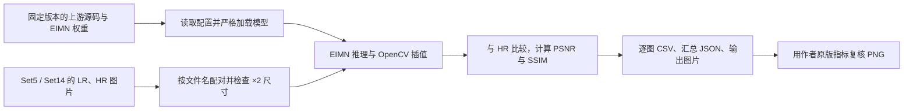

# 项目与文件指南

从 [README](../README.md) 可以直接开始运行。本指南适合第一次读代码、查结果或接手复现的人。命令中的相对路径以项目根目录为起点。文件表逐项覆盖 Git 里的项目文件，本地下载的上游源码、批量图片和按次生成的日志按用途说明。

## 项目在回答什么问题

给同一张低分辨率图片两种放大方案，分别使用 EIMN_L 官方权重和 OpenCV 双三次插值。然后把两张结果各自与对应的高清图比较。先检查能否得到接近论文的结果，再检查同一张输出交给 BasicSR 与 EIMN 作者的指标代码时，两套工具得到的分数是否一致。

| 术语 | 在项目里指什么 |
| --- | --- |
| LR 和 HR | LR 是送给模型的低分辨率图，HR 是评估时用于对照的高清参考图。 |
| ×2 | 输出宽、高各为 LR 的两倍。 |
| EIMN_L | 论文的模型版本之一，本项目使用作者发布的 ×2 权重。权重文件包含模型运行所需的参数。 |
| OpenCV bicubic | 双三次插值对照方法。它使用相邻像素计算放大后的像素值。 |
| PSNR | 峰值信噪比，单位 dB。相同评测条件下，越高通常表示与参考图的像素误差越小。 |
| SSIM | 结构相似度。相同评测条件下，越接近 1 通常表示亮度、对比度和结构越相似。 |
| Y 通道和裁边 | Y 指亮度分量。默认评测先将输出裁剪并取整为 8 位像素，用 Y 通道比较，并排除图像四周各 2 像素。 |
| SHA-256 | 文件内容的指纹。将结果表与数据清单中的哈希对照，可确认每次用了哪些文件。 |

例如，`data/benchmark/Set5/LR_bicubic/X2/img_001x2.png` 与 `data/benchmark/Set5/HR/img_001.png` 配对。程序用前者产生 EIMN 与 bicubic 两张输出，用后者计算这两张输出各自的分数。首轮记录里的两行 PSNR 分别是 **38.9662 dB** 和 **37.3090 dB**。这是一张图的成绩，Set5 的平均分要看汇总文件。[逐图数据](../artifacts/runs/20261123-140139/per_image.csv) · [首轮汇总](../artifacts/runs/20261123-140139/summary.json)

## 从输入到结果

在一键流程中，指标复核之后还会用随机图检查三步训练能否执行并恢复检查点。这一步独立于 Set5、Set14 评分。

## 文件索引

### 根目录和配置

| 文件 | 作用 | 输入 | 输出或可查信息 |
| --- | --- | --- | --- |
| [README.md](../README.md) | 项目入口与快速运行说明。 | 已验收的实验和现有命令。 | 项目目标、首轮分数和文档导航。 |
| [PROGRESS.md](../PROGRESS.md) | 按阶段记录进展。 | 完成的工作、验证及待办。 | 当前状态、验证结果和下一步。 |
| [LICENSE](../LICENSE) | 本项目自有代码的 MIT 许可。 | 作者、许可和版权条款。 | 使用与分发条款。上游和数据各自沿用来源许可。 |
| [.gitignore](../.gitignore) | 指定 Git 应忽略的本地文件。 | 路径和文件名匹配规则。 | Git 跳过数据、上游源码、日志、输出图片、权重等。 |
| [pyproject.toml](../pyproject.toml) | 项目元数据和 pytest 搜索路径。 | 项目名、版本、Python 下限和测试目录。 | 工具读取的项目配置。实际一键流程用 `unittest`。 |
| [requirements-lock.txt](../requirements-lock.txt) | 记录本机验证过的主要依赖版本。 | 实测 Python 环境中的包。 | 版本重建参考，CUDA 版 PyTorch 安装见环境说明。 |
| [configs/eimn_x2.json](../configs/eimn_x2.json) | 默认评测设置。 | 倍率、模型、数据集、目录、权重、设备、评测口径和论文参考值。 | 评测程序读取配置，运行汇总保留该次配置快照。 |

### 运行入口

| 文件 | 作用 | 输入 | 输出 |
| --- | --- | --- | --- |
| [tools/run_stage1.ps1](../tools/run_stage1.ps1) | 串联完整的首阶段流程。 | `-Python` 指定的解释器，可用的运行环境。 | `artifacts/runs/<运行编号>/`、各阶段日志和成功索引。 |
| [tools/bootstrap_runtime.py](../tools/bootstrap_runtime.py) | 准备固定提交的 EIMN、BasicSR 源码。 | 两个上游源码 ZIP 或网络下载，`--tools-dir` 可指定缓存根目录。 | 解压到 `vendor/`，记录来源和归档哈希到 `artifacts/upstream-downloads.json`。 |
| [tools/prepare_benchmarks.py](../tools/prepare_benchmarks.py) | 获取固定版本的图片，校验文件及倍率。 | SelfExSR 固定提交或已缓存数据。用 `--cache` 指定缓存，`--root` 指定输出项目目录。 | `data/benchmark/` 中 19 对配图、`artifacts/data_manifest.json` 和终端计数。 |
| [tools/verify_reference_metrics.py](../tools/verify_reference_metrics.py) | 对完整默认实验，用 EIMN 原版度量代码重新计算分数。 | `--run` 指向的汇总、CSV、19 张 EIMN 输出 PNG，以及对应 HR。 | `reference_metric_check.json`。记录逐图偏差和最大值，检查失败时返回错误。 |
| [tools/api_delegate.py](../tools/api_delegate.py) | 独立运行外部模型审阅。 | `--provider claude\|grok\|both`、`--max-output-tokens`、本地客户端的 API 配置以及脚本里的固定任务。 | 审阅稿、终端状态及 `logs/api_calls.jsonl`。同一任务有成功记录时会跳过再次调用。 |

### 怎样改评测设置

将 `configs/eimn_x2.json` 复制为实验配置，再通过 `--config` 指向副本。同一次运行中，下面这些值要彼此对应。

| 配置项 | 默认值与含义 |
| --- | --- |
| `model`、`scale`、`weight` | 当前入口支持 `EIMN_L`。默认倍率为 2，权重为 `EIMN_L_x2.pth`。调整倍率时，权重、LR 目录及论文参考值也要对应。 |
| `datasets`、`data_root` | 默认从 `data/benchmark` 下读取 `Set5`、`Set14`。每个数据集需要 `HR` 和对应的 `LR_bicubic/X<倍率>` 目录。 |
| `vendor_eimn`、`vendor_basicsr` | 模型源码和指标源码的本地根目录。 |
| `device` | 默认 `cuda`。单独跑评测时可在副本中改为 `cpu`，报告会记录设备，CPU 前向时间应按对应设备理解。 |
| `crop_border`、`test_y_channel`、`quantize_before_metric` | 默认裁去四周 2 像素、计算亮度指标、在计算前裁剪并取整。改变这些项会改变得分口径。 |
| `paper_reference` | 每个数据集对应 `[论文 PSNR, 论文 SSIM]`。汇总用其中的 PSNR 计算差值。 |

`--output` 只对单次评测指定写入位置。`--limit 1` 表示每个数据集最多评测 1 对图片。要保存可比较的结果，为每次评测选一个新输出目录。

### Python 实现

| 文件 | 作用 | 输入 | 输出 |
| --- | --- | --- | --- |
| [sr_lab/__init__.py](../sr_lab/__init__.py) | 声明 `sr_lab` 包。 | Python 导入。 | 包的说明字符串。 |
| [sr_lab/evaluate.py](../sr_lab/evaluate.py) | 主评测入口，推理、插值、计算指标并保存结果。 | `--config`、`--output`、`--limit`，以及 LR/HR、权重和上游指标代码。 | 逐图 CSV、汇总 JSON、两种方法各自的 PNG、终端逐图 JSON。每完成一个数据集写一次表。 |
| [sr_lab/pairs.py](../sr_lab/pairs.py) | 通过文件名 ID 配对。 | HR 目录、LR 目录和倍率。 | 排序后的 `(图像 ID, LR 路径, HR 路径)`。重复、缺失或空目录触发错误。长宽校验在评测入口。 |
| [sr_lab/upstream.py](../sr_lab/upstream.py) | 接入 EIMN 模型与 BasicSR 指标。 | 上游目录、权重文件、设备和倍率。 | 严格加载参数后的 EIMN_L 模型，以及可调用的 BasicSR PSNR、SSIM 计算函数。 |
| [sr_lab/report.py](../sr_lab/report.py) | 处理 JSON 中的特殊数值。 | 数字、字典和列表。 | 普通数字保持原样，非有限数字写成字符串 `Infinity`、`-Infinity` 或 `NaN`。 |
| [sr_lab/train_smoke.py](../sr_lab/train_smoke.py) | 验证反向传播、参数更新和检查点恢复。 | 默认配置中的设备和权重。固定随机种子的 16×16 输入及双线性放大的目标。 | 三步 loss、是否更新参数及是否恢复成功，写到 `artifacts/training_smoke.json`，另外保存本地检查点。 |

### 测试

按 README 设置 `$srPython` 后，用 `& $srPython -m unittest discover -s tests -v` 运行。测试显示通过、失败和报错。一键脚本将其写入 `logs/<运行编号>-tests.log`。

| 文件 | 检查内容 | 输入 | 预期结果 |
| --- | --- | --- | --- |
| [tests/test_pairs.py](../tests/test_pairs.py) | 图像 ID 配对和拒绝错配。 | 临时 HR/LR 文件名，包含正常、缺图和重复 ID。 | 正常配对成功，缺图和重复 ID 报错。 |
| [tests/test_metrics_protocol.py](../tests/test_metrics_protocol.py) | 两套指标实现的颜色顺序和裁边。 | 合成彩色图、边缘改动的合成图，以及两份上游指标源码。 | 对齐 RGB/BGR 后结果一致，裁去的边缘改动不影响分数。 |
| [tests/test_report.py](../tests/test_report.py) | 严格 JSON 序列化。 | 包含普通数、Infinity 和 NaN 的示例。 | 特殊值可被标准 JSON 解析为字符串，普通分数保留为数字。 |
| [tests/test_api_delegate.py](../tests/test_api_delegate.py) | API 参数和日志处理。 | 模拟凭据、响应、用量和临时日志。 | 验证限额、重定向处理、输出提取、成功后跳过等行为。测试采用离线模拟。 |

### 说明与审阅

| 文件 | 作用 | 依据 | 可查信息 |
| --- | --- | --- | --- |
| [docs/PROJECT_GUIDE.md](PROJECT_GUIDE.md) | 本指南。 | 当前代码、配置和实验产物。 | 术语、文件职责、数据流、结果字段和排错。 |
| [docs/ENVIRONMENT.md](ENVIRONMENT.md) | 记录环境的搭建与验证。 | 本机 Python、PyTorch、CUDA、显卡和上游版本。 | 解释器路径、依赖准备、下载缓存和重建方法。 |
| [docs/DATASETS.md](DATASETS.md) | 交代测试数据来源与布局。 | SelfExSR 固定版本及数据校验。 | LR/HR 文件名、哈希校验、下载和重放方式。 |
| [docs/RESULTS_STAGE1.md](RESULTS_STAGE1.md) | 解读首轮实测。 | 评测汇总、原版指标复核、论文表 1 和训练诊断。 | 分数差异、对照方法、计时范围和实验局限。 |
| [docs/TASKS.md](TASKS.md) | 记录原始任务分工。 | 环境、数据、评测、外部审阅的职责。 | 任务与验收对应关系。实际完成情况以进度记录为准。 |
| [docs/API_DELEGATION.md](API_DELEGATION.md) | 解释可选的 API 审阅流程。 | 两套本地配置和脱敏用量记录。 | 真实服务、模型、调用入口、用量和审阅边界。 |
| [docs/ai_reviews/claude_review.md](ai_reviews/claude_review.md) | 第一套配置的复现检查建议。 | DeepSeek 响应和本地核对备注。 | 列出权重、数据、评测等建议及被纠正之处。 |
| [docs/ai_reviews/grok_review.md](ai_reviews/grok_review.md) | 第二套配置的边界情况审阅。 | 火山方舟豆包响应和本地核对备注。 | 列出配对、序列化、计时等建议及被纠正之处。 |

### 实验产物

| 文件 | 怎样生成 | 用来回答什么问题 |
| --- | --- | --- |
| [artifacts/data_manifest.json](../artifacts/data_manifest.json) | 数据脚本校验上游 Git blob、图片尺寸和字节后写出。 | 每张图片来自什么提交，保存在何处，宽高和哈希是什么。 |
| [artifacts/environment.json](../artifacts/environment.json) | 初始化环境时记录本机版本与 GPU 检查结果。 | 首轮用什么硬件和软件跑，官方权重是否严格加载。 |
| [artifacts/upstream-downloads.json](../artifacts/upstream-downloads.json) | 上游准备脚本下载或复用 ZIP，计算 SHA-256 后写出。 | EIMN 与 BasicSR 来自哪个提交，缓存和解压目录在哪。 |
| [artifacts/latest_stage1.json](../artifacts/latest_stage1.json) | 一键流程所有步骤通过后写出。 | 最近一次成功运行的编号、状态和结果目录。 |
| [artifacts/training_smoke.json](../artifacts/training_smoke.json) | 训练诊断读取官方权重并运行三步优化后写出。 | 每步 loss、参数是否变化、是否成功恢复。新运行会刷新该文件。 |
| [artifacts/runs/20261123-140139/per_image.csv](../artifacts/runs/20261123-140139/per_image.csv) | 主评测入口对每张图、每种方法记录一行。 | 哪张图取得什么分数，使用了什么输入，模型前向耗时是多少。 |
| [artifacts/runs/20261123-140139/summary.json](../artifacts/runs/20261123-140139/summary.json) | 主评测按数据集及方法求均值。 | 平均质量、样本数、权重哈希、评测口径及与论文 PSNR 的差值。 |
| [artifacts/runs/20261123-140139/reference_metric_check.json](../artifacts/runs/20261123-140139/reference_metric_check.json) | 复核工具读取输出图和 HR，用作者原版指标重新评分。 | 两套实现每张图相差多少，是否通过实现一致性检查。 |

### 本地数据、源码和日志

| 路径 | 来源与用途 |
| --- | --- |
| `data/benchmark/<数据集>/HR/*.png` 与 `LR_bicubic/X2/*.png` | 评测的高清参考图、低分辨率输入图。数据准备脚本保留上游原始 PNG 字节。 |
| `vendor/EIMN/Model/EIMN.py`、`Model/Transformer_Block.py` | 作者模型结构、主要模块与辅助层。模型入口取其中的 `EIMN_L`。 |
| `vendor/EIMN/Weights/EIMN_L_x2.pth` | 用于首轮评测与训练诊断的作者权重。 |
| `vendor/EIMN/Metrics/psnr_ssim/` | 作者原版指标实现，供复核脚本与交叉测试读取。 |
| `vendor/BasicSR/basicsr/metrics/psnr_ssim.py`、`metric_util.py` | 主评测使用的指标及图像转换辅助函数。 |
| `vendor/BasicSR/basicsr/utils/color_util.py`、`registry.py` | BasicSR 色彩转换及指标注册所需的依赖。上游其余文件随源码包保留。 |
| `artifacts/runs/<运行编号>/images/<数据集>/<方法>/*.png` | 一键评测保存的 8 位输出图，供目视检查和原版分数复核。 |
| `artifacts/evaluation_x2/` | 直接运行评测模块且省略 `--output` 时的默认输出目录。每次可以指定不同目录保存结果。 |
| `artifacts/checkpoints/synthetic_smoke.pth` | 合成数据诊断保存的模型、优化器状态和步数，用于检查恢复流程。 |
| `logs/<运行编号>-{bootstrap,data,tests,evaluation,reference-check,training-smoke}.log` | 分别记录上游准备、数据准备、测试、评测、指标复核、训练诊断。排错从报错所指的日志开始。 |
| `logs/runtime-setup.log` 与 `logs/api_calls.jsonl` | 分别记录初始环境搭建和外部审阅调用。API 日志含模型、任务、状态与用量。 |
| `D:/CodexTools/downloads.json`、`sr-reproduction/`、`sr-data-downloads/` | 项目外的全局下载清单、解释器与上游归档缓存、数据下载缓存。后两项均位于 `D:/CodexTools` 下。 |

## 怎样读输出

**先看汇总。** `summary.json` 的 `results` 中，每组 `dataset` 和 `method` 对应一条平均成绩。用 `count` 检查样本数，用 `limited_run` 确认有无运行限制。`paper_psnr_delta` 是实测 EIMN 平均 PSNR 减去论文同一数据集的参考值。OpenCV 对照行用 `null`。该差值受数据版本与评测口径影响。

**想追到某张图，就看 CSV。** `dataset`、`image`、`method` 共同定位一行。`psnr` 和 `ssim` 是单图分数。`lr_sha256`、`hr_sha256` 可与数据清单核对。`model_forward_ms` 为预热后单次前向耗时。CUDA 路径同步 GPU，时间范围为模型前向，读写、传输和指标计算在计时外。`peak_allocated_mib` 是 CUDA 已分配显存峰值，包含模型及已有张量占用。OpenCV 的时间、显存列留空，CPU 路径上的显存也留空。

**想知道评测代码是否一致，看复核文件。** 首轮有 19 对，PSNR 最大差约 0.0000038 dB，SSIM 最大差为 0。`implementation_tolerance` 用于判断两份指标实现能否给出一致结果。论文差值仍需结合图片来源分析。

**想知道训练诊断是否通过，看三个字段。** `steps` 应为 3，`parameters_changed` 和 `checkpoint_reload` 应为 `true`。loss 只衡量固定合成样本的训练过程，真实数据上的效果需另做实验。

## 按现象排查

| 现象 | 优先检查 |
| --- | --- |
| 找不到解释器或 CUDA 不可用 | 看环境说明，核对 `-Python` 是否指向已安装依赖的环境，再检查配置里的 `device`。 |
| 找不到数据、模型代码或权重 | 先看一键流程的 bootstrap 和 data 日志。也可分别运行数据准备与上游准备脚本。 |
| 出现 `Unpaired IDs` 或 `Wrong spatial ratio` | 检查 LR 文件名的倍率后缀、对应 HR 的 ID，以及宽、高是否都符合倍率。 |
| 只看到几个结果或复核要求 19 张图 | 检查 `limited_run` 和 `count`。快速检查每个数据集只跑一张。复核脚本要求完整默认实验的 19 张 EIMN 输出，并使用取整协议。 |
| GitHub 上没有输出图片或本地日志 | 通过一键入口在本机生成。仓库提供已验收的 CSV、JSON 和下载记录。 |
| 直接运行评测后，成功索引还是原来的路径 | 单独评测只写 `--output` 所指定的目录。一键流程全部通过后才刷新成功索引。 |
